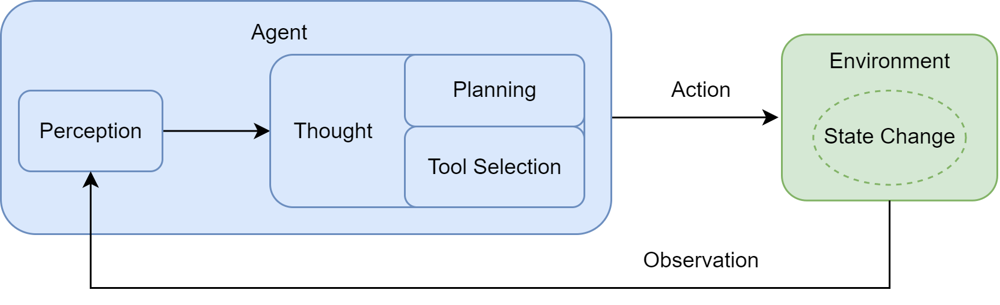

第一章：初识智能体（AI Agent）
================================

1. 什么是 Agent？
-----------------

Agent（智能体）是能够感知环境、自主决策并执行行动，以完成特定目标的系统。

Agent 的四个基本要素：

- Environment：环境，智能体所处的外部世界。
- Sensors：传感器，获取环境信息。
- Actuators：执行器，通过工具或设备执行行动。
- Autonomy：自主性，根据环境信息自主决策。

核心运行模式::

    感知环境 → 自主决策 → 执行行动 → 获取反馈 → 循环

2. Agent 的分类
---------------

2.1 按决策架构分类
~~~~~~~~~~~~~~~~~~

- Simple Reflex Agent：基于条件规则进行决策。
- Model-Based Agent：维护内部世界模型，具备记忆能力。
- Goal-Based Agent：根据目标规划行动。
- Utility-Based Agent：通过效用函数选择最优行动。
- Learning Agent：通过环境反馈学习和优化策略。

2.2 按决策方式分类
~~~~~~~~~~~~~~~~~~

- Reactive Agent：快速响应环境变化。
- Deliberative Agent：通过推理和规划进行决策。
- Hybrid Agent：结合快速响应与长期规划。

2.3 按知识表示分类
~~~~~~~~~~~~~~~~~~

- Symbolic AI：基于符号和逻辑规则。
- Sub-symbolic AI：基于神经网络学习。
- Neuro-Symbolic AI：结合神经网络与符号推理。

3. LLM Agent 的核心原理
-----------------------

LLM Agent 使用大语言模型作为决策核心，结合外部工具完成复杂任务。

主要能力：

- Planning：将复杂任务拆解为多个子任务。
- Tool Use：自主选择和调用外部工具。
- Memory：利用历史信息辅助决策。
- Reflection：根据执行反馈调整后续行动。

3.1 Agent Loop
~~~~~~~~~~~~~~~

.. image:: images/agent_1_1.png

Agent Loop 是智能体的核心运行机制::

    User Input
        |
        v
    Thought（思考与规划）
        |
        v
    Action（工具调用）
        |
        v
    Observation（执行反馈）
        |
        v
    判断任务是否完成
        |
        +-- No  → 返回 Thought
        |
        +-- Yes → Finish

其中：

- Thought：分析任务并决定下一步行动。
- Action：生成工具调用或任务结束指令。
- Observation：接收工具执行结果，更新上下文。

注意：LLM 负责生成工具调用指令，
真正的工具执行由外部程序完成。

4. Agent 的基本实现
--------------------

一个简单的 LLM Agent 主要包含以下模块：

- LLM：负责推理、规划和决策。
- System Prompt：定义角色、工具和输出格式。
- Tools：提供访问外部环境的能力。
- Prompt History：保存历史交互信息。
- Agent Loop：控制模型调用、工具执行和任务终止。

核心执行流程::

    1. 接收用户任务
    2. 构建 Prompt
    3. 调用 LLM 生成 Action
    4. 解析并执行工具
    5. 将 Observation 加入历史上下文
    6. 重复执行，直到 Finish

示例：智能旅行助手::

    User: 根据北京天气推荐景点

    Thought: 需要先查询天气
    Action: get_weather("北京")

    Observation: 北京晴天，26℃

    Thought: 查询适合晴天的景点
    Action: get_attraction("北京", "Sunny")

    Observation: 推荐颐和园

    Action: Finish[推荐前往颐和园]

5. Workflow 与 Agent 的区别
---------------------------

Workflow（工作流）：

- 执行流程由开发者预先定义。
- 适合稳定、标准化的任务。
- 可预测性高，但灵活性较低。

Agent（智能体）：

- 根据目标自主规划执行步骤。
- 可以动态选择工具和调整计划。
- 适合复杂、开放式任务。

核心区别：

Workflow 由预定义流程驱动，
Agent 由目标和动态决策驱动。

6. Agent 的应用模式
--------------------

开发者工具型：

- GitHub Copilot
- Cursor
- Claude Code

主要用于代码生成、调试、重构等任务。

自主协作者型：

- 单 Agent 自主循环。
- Multi-Agent 多智能体协作。
- 基于状态图的复杂控制流。

代表框架：

- CrewAI
- AutoGen
- MetaGPT
- LangGraph

7. 本章总结
-----------

本章最重要的五个知识点：

1. Agent 的核心是感知、决策、行动和反馈。
2. LLM 为 Agent 提供推理与规划能力。
3. Agent Loop 是实现自主执行的核心机制。
4. Agent 通过 Tool Calling 与外部环境交互。
5. Workflow 强调预定义流程，Agent 强调自主决策。

8. 个人感受
--------------------

1. 它作为一个强大的辅助工具。它增强而非取代开发者的角色，通过自动化处理繁琐、重复的任务，让开发者能更专注于 **创造性的核心工作** 。

2. 简单来说，Workflow 是让 AI 按部就班地执行指令，而 Agent 则是赋予 AI 自由度去自主达成目标。工作流是一种传统的自动化范式，其核心是 **对一系列任务或步骤进行预先定义的、结构化的编排** 。与工作流不同，基于大型语言模型的智能体是一个 **具备自主性的、以目标为导向的系统** 。

3. 核心机制 agent loop `` Thought-Action-Observation `` 。

.. image:: images/agent12.png

.. image:: images/agent13.png